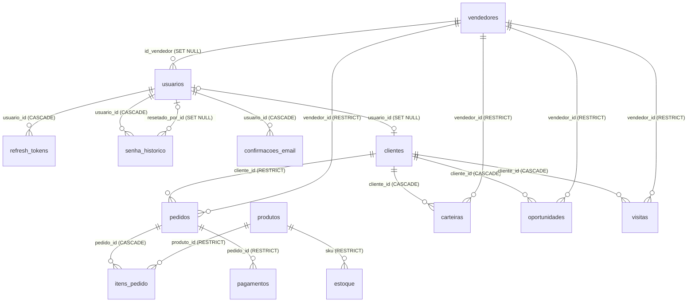

# Manual da base de dados

**Banco:** MariaDB 11.4 LTS, schema `rotaperfumes` (`DB_NAME?=rotaperfumes`), `utf8mb4` / `utf8mb4_unicode_ci`, InnoDB em todas as tabelas.
**Fonte da verdade:** `sql/schema.sql` (14 tabelas, versão atual) e `sql/migracao.sql`. Se este manual divergir deles, vale o SQL.
**Ambientes:** dev = MariaDB 11.8 do CasaOS (`192.168.168.106:3307`, CA `deploy/ca-cert.pem`); produção = container `rotaperfumes-mariadb` (`docs/deploy-servidor.md`, seções 3 e 11).

## Sumário

1. [Convenções](#1-convenções) · [Diagrama](#2-diagrama-de-relacionamentos) · [Criar e atualizar o banco](#3-criar-e-atualizar-o-banco)
2. Tabelas: [`vendedores`](#5-tabela-vendedores), [`usuarios`](#6-tabela-usuarios), [`refresh_tokens`](#7-tabela-refresh_tokens), [`senha_historico`](#8-tabela-senha_historico), [`clientes`](#9-tabela-clientes), [`carteiras`](#10-tabela-carteiras), [`oportunidades`](#11-tabela-oportunidades), [`visitas`](#12-tabela-visitas), [`produtos`](#13-tabela-produtos), [`pedidos`](#14-tabela-pedidos), [`itens_pedido`](#15-tabela-itens_pedido), [`pagamentos`](#16-tabela-pagamentos), [`estoque`](#17-tabela-estoque), [`confirmacoes_email`](#18-tabela-confirmacoes_email)
3. [Pontos a confirmar](#22-pontos-a-confirmar) · [Credenciais e cliente `mariadb`](#23-credenciais-do-banco-e-cliente-mariadb) · [Backup e restauração](#24-backup-e-restauração-do-banco-e-das-imagens)

## 1. Convenções

- **Controle:** quase todas as tabelas têm `created_at` e `updated_at` (`TIMESTAMP`, `DEFAULT CURRENT_TIMESTAMP [ON UPDATE ...]`); `senha_historico` e `confirmacoes_email` só `created_at`.
- **PK de origem:** `clientes`, `pedidos`, `itens_pedido`, `carteiras` (`*_id_origem`) e `pagamentos`, `oportunidades`, `visitas` (`*_id`) usam o id do CSV como PK; os importadores gravam o id (upsert na PK). As demais têm `id` próprio.
- **Tipos:** booleanos `TINYINT(1)` 0/1 (S/N no CSV); totais `DECIMAL(15,2)`, preços `DECIMAL(10,2)`, percentuais `DECIMAL(5,2)` (5.00 = 5%).
- **FKs para `clientes`** apontam para `cliente_id_origem`; todas usam `ON UPDATE CASCADE`, exceto as de `senha_historico` (padrão do MariaDB).

**Exclusão** (adapters `backend/shared/<contexto>/<contexto>mysql`):

| Tabela | Como é "excluída" |
| --- | --- |
| `vendedores` | Lógica: `data_desligamento` (`DELETE /api/vendedores/{id}`); reativar limpa a data |
| `usuarios`, `clientes`, `produtos` | Lógica: `ativo = 0`; sem DELETE físico |
| `pedidos` (+ itens) | Física, numa transação; bloqueada com pagamento vinculado ou status Faturado |
| `pagamentos`, `carteiras`, `oportunidades`, `visitas` | Física |
| `refresh_tokens` | Revogação (`revoked_at` + `revoked_reason`); limpeza periódica pela API (7.2) |
| `estoque`, `senha_historico` | Sem DELETE no repositório |

### 1.1 Fuso horário (DB-08)

- A API, os importadores e as CLIs Go fixam `time_zone='-03:00'` na sessão pelo DSN (`tz.OffsetSQL`, com `loc=Local`); o `DEFAULT CURRENT_TIMESTAMP` fica coerente com o Go, com o servidor em UTC ou em -03.
- `TIMESTAMP` guarda o instante e converte pelo fuso da sessão; `DATETIME` e `DATE` são "naive". A CLI `mariadb` e os seeds usam o fuso do servidor, salvo `SET time_zone = '-03:00';`.
- Nenhum SQL da aplicação usa o relógio do servidor (`NOW()`, `CURDATE()`): datas vêm do Go por `?` (TST-23, BUG-30). Exceção: o `DEFAULT` das colunas de auditoria.

## 2. Diagrama de relacionamentos

Entre parênteses, a regra `ON DELETE`.



- Cliente com pedidos não é apagado (`RESTRICT`); sem pedidos, leva carteiras, oportunidades e visitas. Na prática a API só inativa.
- Vendedor com pedidos, carteiras, oportunidades ou visitas não é apagado; a API só desliga. Pedido com pagamentos não é apagado; itens vão junto.
- Produto com itens ou estoque não é apagado; a troca do `sku` propaga para `estoque`.

## 3. Criar e atualizar o banco

| Comando | O que faz |
| --- | --- |
| `make db-up` | `db-create` (`CREATE DATABASE IF NOT EXISTS`) + `sql/schema.sql` (tabelas vazias) |
| `make db-seed` | `db-up` (por sub-make, BUG-28) + `sql/seed_admin.sql` + `sql/seed_vendedores.sql` + `resetpassword -list`, `-create-admin`, `-all-users` (só dev) |
| `make db-reset` | `db-down` (DROP) e `db-seed`, em sequência; para na primeira falha, mesmo com `-k`/`-j` (BUG-27) |
| `make db-rebuild` | `db-reset` + todos os `db-import-*` na ordem das dependências |
| `make db-migrar` | `sql/migracao.sql` num banco existente (idempotente, não destrutivo) |
| `make db-seed-mes-atual` | `sql/seed_movimentacoes_mes_atual.sql`: movimentos de exemplo no mês corrente; idempotente |
| `make db-import-*` | Upsert idempotente de `dados/crm/*.csv` e `dados/erp/*.csv`: clientes e produtos, depois pedidos (e itens), pagamentos, carteiras, oportunidades, visitas, estoque |
| `make db-gerar-imagens-produtos` | PNG por produto sem imagem (IMG-01; `GERAR_IMAGENS_FLAGS=-sobrescrever` ou `-dry-run`) |
| `make db-export` | Exporta as tabelas para CSV em `export/crm` e `export/erp` |

**`sql/migracao.sql`:**
- Leva qualquer banco da base de 2026-10-31 em diante (com `produtos.imagem`) à versão do `schema.sql`; rodar de novo não muda nada. O Jenkins (estágio `Migracoes`) roda só ele.
- Recusa, sem alterar nada, banco mais antigo e `senha_historico.created_at` NULL (remédio no cabeçalho do arquivo). Também garante o vendedor "Loja Online" e preenche `entrega_*` de pedidos antigos com endereço fictício.
- Não há revert: volta-se pelo backup (`deploy/backup-banco.sh`, seção 24). Mudança de schema = editar `schema.sql` e `migracao.sql`.

**Seeds:**
- `seed_admin.sql`: upsert do admin (id 1, `admin@rotaperfumes.com.br`) com hash placeholder e `deve_trocar_senha = 1` (também no `ON DUPLICATE KEY UPDATE`).
- `seed_vendedores.sql`: 42 vendedores (ids 1..42) + "Loja Online" (sem login) e um usuário `normal` por vendedor, `INSERT IGNORE` (não recria linhas). Vendedores desligados (1, 3, 9, 30, 37, 38) têm usuário sempre `ativo = 0`.
- `seed_pedidos.sql` está descontinuado (só comentários; pedidos vêm do `make db-import-pedidos`). O `-all-users` troca os placeholders por Argon2id (com `PASSWORD_PEPPER`).

**Produção:** seed só pelo `deploy/seed-producao.sh` (schema.sql, seeds, todos os não-admin inativos, `-create-admin`, sem `-all-users`). Atualização: Jenkins `Migracoes`, ou `make db-migrar ENV_ARQUIVO=backend/.env.producao CONFIRMO_PRODUCAO=<DB_HOST>/<DB_NAME>`.

**Guardas do Makefile:**
- `db-guard-producao` (DEPLOY-07): todo alvo que escreve no banco recusa a produção (host e porta), salvo `CONFIRMO_PRODUCAO=<DB_HOST>/<DB_NAME>` na linha de comando. O CasaOS `:3307` passa.
- `db-guard-sem-producao` (SEC-46): `db-down`, `db-seed`, `db-reset` e `db-rebuild` recusados sempre na produção. `db-guard-drop`: fora do loopback, o DROP de `rotaperfumes` exige `CONFIRMAR=<DB_NAME>`.
- SEC-54/56/57: `DB_HOST` normalizado; IPv4 não canônico e porta não numérica recusados. `make test-integration` usa só `rotaperfumes_teste` (TST-25), no loopback ou no CasaOS `:3307`.
- BUG-29: use `make -k ...`, nunca `make ... MAKEFLAGS=-k`; `ENV_ARQUIVO` só na linha de comando, relativo à raiz.

## 5. Tabela `vendedores`

- Colunas: `id` (PK; os CSVs usam os mesmos ids 1..42), `nome` VARCHAR(120), `regiao` VARCHAR(80), `uf` CHAR(2), `data_admissao` DATE, `data_desligamento` DATE NULL (**NULL = ativo**), `meta_mensal` DECIMAL(15,2) (padrão 0).
- Índice só `PRIMARY` (sem UNIQUE de nome). Referenciada por `usuarios` (SET NULL) e por pedidos, carteiras, oportunidades e visitas (RESTRICT).
- Desligar grava a data (`COALESCE`) e, na mesma transação, inativa os usuários vinculados, grava o corte e revoga os tokens (`inativacao`).

## 6. Tabela `usuarios`

| Campo | Tipo | Nulo | Descrição |
| --- | --- | --- | --- |
| `id` | BIGINT AI | não | PK; `sub` do JWT |
| `nome` | VARCHAR(120) | não | |
| `email` | VARCHAR(120) | não | UNIQUE `uk_usuarios_email`; minúsculas, sem espaços nas pontas |
| `password_hash` | VARCHAR(255) | não | Argon2id PHC com pepper (SEC-13); bcrypt legado migra no login |
| `role` | ENUM('admin','normal','usuario') | não | padrão `normal`; `usuario` = cliente da loja (só `/loja`, 403 nas rotas internas, sem vendedor) |
| `id_vendedor` | BIGINT | sim | FK `fk_usuarios_vendedor` (SET NULL); escopo do `normal` |
| `ativo` | TINYINT(1) | não | padrão 1 |
| `deve_trocar_senha` | TINYINT(1) | não | 1 = troca obrigatória no próximo login |
| `email_confirmacao_pendente` | TINYINT(1) | não | 1 = autocadastro da loja sem confirmar (login 403) |
| `tokens_validos_desde` | DATETIME | sim | corte de sessão (6.1) |
| `ultimo_login_at` | TIMESTAMP | sim | |

- Índices: `uk_usuarios_email`, `idx_usuarios_role`, `idx_usuarios_ativo`, `idx_usuarios_id_vendedor`.
- `deve_trocar_senha = 1` na senha gerada pelo sistema (criação e reset pelo admin, seeds, `-create-admin`); volta a 0 na troca pelo usuário. O `-all-users` não mexe na coluna.

### 6.1 `tokens_validos_desde` (SEC-08)

- `NULL` = sem corte. Com valor, access token com `iat <= corte` (ou sem `iat`) recebe 401 `"sessão encerrada — faça login novamente"`. Valor vindo do Go, truncado no segundo.
- Gravado em: inativação (`SetAtivo(false)`), desligamento do vendedor (`InativarByVendedorID`), troca/reset de senha (`UpdatePasswordHash`), reuso de refresh rotacionado (`InvalidarSessoes`) e CLI `resetpassword`.
- Não grava corte: reativação e logout. Sem índice (lido pela PK).

## 7. Tabela `refresh_tokens`

| Campo | Tipo | Nulo | Descrição |
| --- | --- | --- | --- |
| `id` | BIGINT AI | não | PK; `token_id` dos logs `[auth]` |
| `usuario_id` | BIGINT | não | FK `fk_refresh_token_usuario` (CASCADE) |
| `token_hash` | VARCHAR(255) | não | SHA-256, UNIQUE `uk_refresh_token_hash`; o token puro nunca é gravado |
| `expires_at`, `revoked_at` | DATETIME | não / sim | `revoked_at` NULL = ativo |
| `revoked_reason` | ENUM('rotacao','logout','revogacao_massa','senha','inativacao') | sim | NULL = ativo ou legado |
| `reuso_detectado_em` | DATETIME | sim | último reuso que cortou sessões (7.1) |
| `ip_origem`, `user_agent` | VARCHAR(45), TEXT | sim | |

Índices: `uk_refresh_token_hash`, `idx_refresh_usuario_id`, `idx_refresh_expires_at`, `idx_refresh_revoked_at`.

| Motivo | Quando |
| --- | --- |
| `rotacao` | `POST /api/auth/refresh` (token antigo trocado na mesma transação) |
| `logout` | `POST /api/auth/logout` |
| `revogacao_massa` | Reuso de token `rotacao` fora da janela de 30 s: todos os tokens do usuário |
| `senha` | Troca pelo usuário ou reset pelo admin |
| `inativacao` | Inativação do usuário ou desligamento do vendedor |

Só o reuso de `rotacao` fora da janela gera alerta `[auth][seguranca]`; a resposta é sempre 401 `"refresh token revogado"`.

### 7.1 `reuso_detectado_em` (SEC-12)

- Supressão por token: `UPDATE ... SET reuso_detectado_em = ? WHERE id = ? AND revoked_reason = 'rotacao' AND (reuso_detectado_em IS NULL OR reuso_detectado_em <= ?)`, com o relógio do Go.
- 1 linha → corta sessões e envia o alerta (SEC-09); 0 linha → reuso repetido na janela, sem novo corte. Fail-closed: erro ao marcar corta assim mesmo; corte falho desfaz a marca.
- Janela `REFRESH_REUSE_SUPPRESS_WINDOW` (padrão `30m`, faixa `1m` a `24h`; fora da faixa a API não sobe).

### 7.2 Limpeza periódica (CHORE-02)

- A própria API (`IniciarLimpezaRefreshTokens`) roda na partida e a cada intervalo: `DELETE ... WHERE expires_at < ? ORDER BY id LIMIT 1000`, em lotes, com `corte = agora - retenção`.
- Nunca apaga linha com `expires_at >= agora`. Sem alvo no Makefile (um DELETE pela CLI usaria o `NOW()` do servidor).

| Variável | Padrão | Faixa |
| --- | --- | --- |
| `REFRESH_TOKEN_RETENCAO` | `720h` | `24h` a `8760h` |
| `REFRESH_CLEANUP_INTERVAL` | `6h` | `0` (desliga) ou `>= 1m` |

## 8. Tabela `senha_historico`

- Colunas: `id` (PK), `usuario_id` (FK CASCADE), `resetado_por_id` NULL (admin que resetou; FK SET NULL), `senha_hash_anterior` VARCHAR(255), `ip_origem`/`user_agent` NULL, `created_at` TIMESTAMP NOT NULL.
- `tipo_reset` ENUM('usuario','admin','primeiro_acesso','esquecimento'); hoje só `usuario` e `admin` são gravados.
- Índices `idx_usuario`, `idx_data`; FKs sem nome declarado e sem `ON UPDATE`. Alimenta o bloqueio de reuso de senha: não apague linhas.
- `created_at` NULL num banco antigo: a `migracao.sql` recusa; o remédio (sentinela `1970-01-01 00:00:01` em -03) está no cabeçalho dela. Restaurar dump antigo pode exigir rodar a migração de novo.

## 9. Tabela `clientes`

| Campo | Tipo | Nulo | Descrição |
| --- | --- | --- | --- |
| `cliente_id_origem` | BIGINT AI | não | PK = `cliente_id` do CSV |
| `cnpj` | CHAR(14) | sim | PJ; UNIQUE `uq_clientes_cnpj`; 14 caracteres, maiúsculas, sem máscara (NEG-02) |
| `cpf` | CHAR(11) | sim | PF da loja; UNIQUE `uq_clientes_cpf` |
| `razao_social`, `segmento`, `cidade`, `uf` | VARCHAR / CHAR(2) | não | |
| `bairro`, `endereco`, `numero`, `complemento`, `cep` | VARCHAR / CHAR(8) | sim | `numero` aceita "s/n"; `cep` só dígitos |
| `data_cadastro` | DATE | não | o importador normaliza `YYYY-MM-DD` e `DD/MM/YYYY` |
| `ativo` | TINYINT(1) | não | padrão 1 |
| `usuario_id` | BIGINT | sim | login da loja; UNIQUE `uq_clientes_usuario`, FK `fk_clientes_usuario` (SET NULL) |

- CHECK `chk_clientes_documento`: `cnpj` ou `cpf` preenchido. Índices `idx_clientes_uf`, `_segmento`, `_ativo`, `_razao_social`.
- CNPJ alfanumérico: 12 posições `[0-9A-Z]` + 2 DVs numéricos; DV validado pela API e pelo frontend (`backend/shared/cnpj`, `frontend/src/lib/cnpj.ts`), não pelo banco. Duplicado → 1062 → API 409 "cnpj já cadastrado".
- A collation `_ci` trata caixas iguais no UNIQUE; confira a caixa com `BINARY cnpj`. Os importadores unificam CNPJs repetidos do CSV (fica o menor id, `importers/clientesdedup`) e recusam formato inválido.

## 10. Tabela `carteiras`

- Colunas: `carteira_id_origem` (PK), `cliente_id` (FK `fk_carteiras_cliente`, CASCADE), `vendedor_id` (FK `fk_carteiras_vendedor`, RESTRICT), `data_inicio` DATE, `data_fim` DATE NULL (**NULL = vínculo ativo**).
- UNIQUE `uk_carteiras_cliente_vendedor_inicio` (`cliente_id`, `vendedor_id`, `data_inicio`); índices em `cliente_id`, `vendedor_id`, `data_fim`. Não há UNIQUE de vínculo ativo.

## 11. Tabela `oportunidades`

- Colunas: `oportunidade_id` (PK), `cliente_id` (FK CASCADE), `vendedor_id` (FK RESTRICT, dono direto), `origem` VARCHAR(80) e `etapa` VARCHAR(40) (texto livre, para não travar o import), `data_abertura` DATE.
- `probabilidade_pct` DECIMAL(5,2) e `valor_estimado` DECIMAL(15,2) (padrão 0); `data_fechamento`, `ciclo_dias`, `motivo_perda` NULL enquanto aberta.
- Índices em `cliente_id`, `vendedor_id`, `etapa`, `origem`, `data_abertura`.

## 12. Tabela `visitas`

- Colunas: `visita_id` (PK), `cliente_id` (FK CASCADE), `vendedor_id` (FK RESTRICT), `data_visita` DATE, `resultado` VARCHAR(40) (texto livre), `duracao_min` INT (padrão 0).
- Índices em `cliente_id`, `vendedor_id`, `data_visita`, `resultado`.

## 13. Tabela `produtos`

| Campo | Tipo | Nulo | Descrição |
| --- | --- | --- | --- |
| `id` | BIGINT AI | não | PK |
| `sku` | VARCHAR(40) | não | UNIQUE `uk_produtos_sku`; chave do upsert e destino da FK de `estoque` |
| `nome` | VARCHAR(255) | não | vitrine, pedidos e estoque |
| `descricao` | TEXT | sim | página da loja |
| `categoria`, `marca` | VARCHAR(80) | não | |
| `nota_olfativa` | VARCHAR(80) | sim | |
| `preco_tabela`, `custo_unitario` | DECIMAL(10,2) | não | |
| `unidade` | VARCHAR(40) | não | ex.: UN, KIT 5 |
| `data_lancamento` | DATE | sim | |
| `ativo` | TINYINT(1) | não | padrão 1 |
| `imagem` | VARCHAR(41) | sim | `<uuid-v4>.jpg|png|webp`; UNIQUE `uk_produtos_imagem` |

- CHECK `chk_produtos_imagem`: `imagem IS NULL OR imagem REGEXP '(?-i)^[0-9a-f]{8}-...-[0-9a-f]{12}\.(jpg|png|webp)$'`; o `(?-i)` é obrigatório por causa da collation `_ci`.
- Índices `idx_produtos_categoria`, `_marca`, `_ativo`.

### 13.1 Imagem do produto (IMG-01)

- Arquivo em `PRODUTO_IMAGENS_DIR` (padrão `./data/produtos-imagens`; deploy: volume `produto_imagens` em `/data/produtos-imagens`); o banco guarda só o nome. URL pública: `/api/public/produtos/imagens/<nome>`.
- Só a API (`POST`/`DELETE /api/produtos/{id}/imagem`) e o `make db-gerar-imagens-produtos` gravam; a troca trava a linha (`FOR UPDATE`) e apaga o arquivo antigo depois do commit.
- Órfãos: `go run ./cmd/limpezaimagens [-dry-run]` (em `backend/shared`) apaga nomes sem referência com mais de 1 h e `.tmp-*` com mais de 24 h; referência sem arquivo só é reportada.
- `-reprocessar-webp [-dry-run]` reencoda os `.webp` (PNG se transparente, JPEG q90) e troca o nome por UPDATE condicional. Rode com o UID 65532 da API, senão ela não lê os arquivos novos.

## 14. Tabela `pedidos`

| Campo | Tipo | Nulo | Descrição |
| --- | --- | --- | --- |
| `pedido_id_origem` | BIGINT AI | não | PK |
| `cliente_id` | BIGINT | não | FK `fk_pedidos_cliente` (RESTRICT) |
| `vendedor_id` | BIGINT | não | FK `fk_pedidos_vendedor` (RESTRICT); loja = "Loja Online" |
| `data_pedido` | DATE | não | |
| `canal` | ENUM('App','Telefone','Visita','WhatsApp','Loja') | não | `Loja` = checkout da loja |
| `status` | ENUM('Cancelado','Em separação','Entregue','Faturado','Aguardando pagamento') | não | loja nasce `Aguardando pagamento` (ECOM-18) |
| `valor_total` | DECIMAL(15,2) | não | calculado no backend |
| `chave_checkout` | CHAR(36) | sim | idempotência do checkout; UNIQUE `uq_pedidos_chave_checkout` |
| `entrega_cep`, `entrega_endereco`, `entrega_numero` | CHAR(8), VARCHAR(255), VARCHAR(20) | não | |
| `entrega_complemento` | VARCHAR(120) | não | padrão `''` |
| `entrega_bairro`, `entrega_cidade`, `entrega_uf` | VARCHAR(120), VARCHAR(120), CHAR(2) | não | |

- CHECK `chk_pedidos_entrega`: CEP de 8 dígitos; rua, número, bairro e cidade não vazios; UF com 2 caracteres.
- Índices em `status`, `canal`, `data_pedido`, `cliente_id`, `vendedor_id`. Exclusão física com itens numa transação.

## 15. Tabela `itens_pedido`

- Colunas: `item_id_origem` (PK), `pedido_id` (FK `fk_itens_pedido_pedido`, CASCADE), `produto_id` (FK `fk_itens_pedido_produto`, RESTRICT; o import resolve o `sku`), `quantidade` INT.
- `preco_praticado` DECIMAL(10,2), `desconto_pct` DECIMAL(5,2) (padrão 0), `valor_bruto` DECIMAL(15,2) (qtd × preço com desconto). Índices em `pedido_id` e `produto_id`.

## 16. Tabela `pagamentos`

| Campo | Tipo | Nulo | Descrição |
| --- | --- | --- | --- |
| `pagamento_id` | BIGINT AI | não | PK |
| `pedido_id` | BIGINT | não | FK `fk_pagamentos_pedido` (RESTRICT) |
| `forma_pagamento` | ENUM('Boleto 14 dias','Boleto 28 dias','Cartão de crédito','Cartão de débito','Cheque a prazo','Dinheiro','PIX') | não | |
| `parcelas` | TINYINT UNSIGNED | não | padrão 1 |
| `valor`, `valor_liquido` | DECIMAL(15,2) | não | líquido = valor menos a taxa |
| `taxa_pct` | DECIMAL(5,2) | não | CHECK `chk_pagamentos_taxa_pct` 0 a 30, inclusivo (SEC-27) |
| `data_vencimento` | DATE | não | |
| `data_pagamento` | DATE | sim | NULL = não pago |
| `status_pagamento` | ENUM('Em aberto','Inadimplente','Pago','Pago com atraso','Recusado') | não | `Recusado` = gateway da loja |

- Índices em `pedido_id`, `status_pagamento`, `data_vencimento`. Fora da faixa da taxa: erro 4025; o domínio responde 400 antes.
- "Pagamento quitado imutável" é regra só do backend (um trigger quebraria o upsert dos importadores).

## 17. Tabela `estoque`

- Colunas: `id` (PK), `data_snapshot` DATE, `sku` VARCHAR(40) (FK `fk_estoque_sku` → `produtos.sku`, RESTRICT), `saldo` INT, `ruptura` TINYINT(1) (padrão 0).
- UNIQUE `uk_estoque_data_sku` (`data_snapshot`, `sku`): chave do upsert do import e da baixa por faturamento (`UpsertPorDataSku`), que podem se sobrescrever no mesmo par.
- Índices em `sku`, `data_snapshot`, `ruptura`. Não há coluna `origem`.

## 18. Tabela `confirmacoes_email`

- Colunas: `id` (PK), `usuario_id` (FK `fk_confirmacoes_email_usuario`, CASCADE), `token_hash` CHAR(64) ascii_bin (SHA-256 hex do link, UNIQUE `uk_confirmacoes_email_token`), `expira_em` DATETIME, `usado_em` DATETIME NULL (NULL = válido), `created_at`.
- Confirmação do autocadastro da loja (ECOM-03): uso único; só o hash do token é gravado.

## 22. Pontos a confirmar

| # | Tabela | Ponto |
| --- | --- | --- |
| 1 | `estoque` | Regra efetiva de `ruptura` (S/N do CSV x `saldo <= 0`; o seed do mês usa saldo 0) |
| 2 | `senha_historico` | Nomes das FKs gerados pelo MariaDB (normalmente `senha_historico_ibfk_1`/`_2`) |
| 3 | `senha_historico` | `primeiro_acesso` e `esquecimento` estão no ENUM, mas só os testes os gravam |
| 4 | `senha_historico` | Teste do BUG-12 usa registro sem usuário, que a FK não deveria aceitar |
| 5 | `vendedores` | Sem UNIQUE de nome: homônimos aceitos; reativar o vendedor reativa os usuários? |

## 23. Credenciais do banco e cliente `mariadb`

- `DB_USUARIO` e `DB_SENHA` são obrigatórios em `backend/.env` (ou no `ENV_ARQUIVO`), sem default. Faltando, a API e as CLIs falham (`ErrCredenciaisDB`) e o `db-check-env` também (`SEC-11: defina DB_USUARIO/DB_SENHA`).
- Só o cliente `mariadb` 11.x (com `client_ed25519`); `DB_CLIENTE_BIN` aponta outro executável MariaDB. Com `DB_TLS_CA`, os alvos passam `--ssl-ca` + `--ssl-verify-server-cert`; host remoto sem CA é recusado (SEC-42).
- Senha fora do argv: o Makefile exporta `MYSQL_PWD` (`MSYS2_ENV_CONV_EXCL = MYSQL_PWD` no Git Bash); `MYSQL_OPTS` = `--local-infile=0 -u ... -h ... -P <porta ou 3306> --default-character-set=utf8mb4`.

Execução manual de um script:

```bash
MYSQL_PWD="$DB_SENHA" mariadb --local-infile=0 -u $DB_USUARIO -h $DB_HOST -P $DB_PORT \
  --default-character-set=utf8mb4 $DB_NAME < sql/<script>.sql
```

**Formato do `.env` (SEC-59):** só linhas vazias, comentários e `[export ]NOME [:?+]=valor` literal; `$`, `\` no fim, diretivas do make e BOM são recusados. Aspas entram no valor; salve com LF.
**SEC-53/55:** os segredos não chegam a `test`, `build`, `lint` e `npm`; as `DB_*` só chegam ao `go test` pelo `make test-integration`.

## 24. Backup e restauração do banco e das imagens

A rotina (`deploy/backup-banco.sh`, instalada em `/usr/local/sbin/rotaperfumes-backup-banco`, timer `rotaperfumes-backup-banco.timer`) está em `docs/deploy-servidor.md`, seção 9. Nenhum alvo do `Makefile` restaura backup.
No servidor em uso, a restauração é só o runbook da 24.5, executado por você; em máquina nova, use o `deploy/restaurar-maquina.sh` (24.6).

### 24.1 Conta `rotaperfumes_backup`

- `rotaperfumes_backup@172.30.42.21`, `ed25519`, `REQUIRE SSL`, só `GRANT SELECT ON rotaperfumes.*`; senha em `/root/rotaperfumes-mariadb/rotaperfumes_backup.senha` (600).
- Option file `/root/rotaperfumes-mariadb/backup-cliente/rotaperfumes_backup.cnf` (400, root; diretório 700), nunca em `container/`.
- Sem `TRIGGER`/`EVENT`, por isso o dump usa `--skip-triggers`; o `sql/` não tem trigger, view, rotina nem evento.

### 24.2 O que o dump leva e o que não leva

```bash
docker run --rm -i --network rotaperfumes-db --ip 172.30.42.21 \
  --read-only --cap-drop ALL --security-opt no-new-privileges:true \
  --mount type=bind,source=/etc/mysql/ssl/ca.pem,target=/run/backup/ca.pem,readonly \
  --mount type=bind,source=/root/rotaperfumes-mariadb/backup-cliente/rotaperfumes_backup.cnf,target=/run/backup/cliente.cnf,readonly \
  --entrypoint mariadb-dump "$IMG" --defaults-extra-file=/run/backup/cliente.cnf \
  -h rotaperfumes-mariadb -P 3306 --ssl-ca=/run/backup/ca.pem --ssl-verify-server-cert \
  --single-transaction --skip-lock-tables --no-tablespaces --skip-add-drop-table --skip-triggers \
  --hex-blob --default-character-set=utf8mb4 rotaperfumes
```

- Sem `USE` e sem `DROP TABLE`: restaurar sobre tabela existente falha com 1050. `TIMESTAMP` sai em UTC e volta ao mesmo instante.
- Cada backup bom é o par dump + `rotaperfumes-imagens-*.tar.gz` (volume `rotaperfumes_produto_imagens`); só os dois restauram o site.

| Fora do dump | Onde fica | Sem ele |
| --- | --- | --- |
| `PASSWORD_PEPPER` | cofre e Secret file `rotaperfumes-api-env` | nenhum login funciona (24.4) |
| `JWT_SECRET` | Secret file | gere outro; só as sessões caem |
| Secret do Turnstile, senha SMTP | Secret file e painéis | obtenha de novo |
| Contas e senhas do banco | `mysql.*`, `/root/rotaperfumes-mariadb` | o `mariadb-docker.sh` recria, com senhas novas |
| CA e certificados | `/etc/mysql/ssl`; chave em mídia offline | `--nova-ca` e fingerprint novo |
| CA do Caddy | volumes `caddy_data`, `caddy_config` | reinstale a raiz nos clientes |
| Jenkins | job e credenciais `rotaperfumes-api-env`, `rotaperfumes-db-admin` | `docs/deploy-servidor.md`, seções 5 e 6 |

### 24.3 Verificar um backup sem tocar na produção

```bash
sudo bash deploy/verificar-backup.sh /var/backups/rotaperfumes/ARQUIVO.sql.gz
```

- Container descartável com `--network none` e tmpfs (`--tmpfs-mb`, padrão 2048; erro 1114 = aumente). Recusa arquivo não regular, gzip inválido, sem `-- Dump completed`, com `USE` ou `CREATE/DROP DATABASE`.
- Aprova com importação OK, pelo menos 13 tabelas, `usuarios`/`vendedores`/`clientes`, um admin e vendedores; `clientes` vazia só gera `AVISO`. Saída 0/1/2; grava `.ultima-verificacao`.
- Rode depois do `--instalar`, uma vez por mês e antes de trocar o digest da imagem.

### 24.4 Pré-requisito: o mesmo `PASSWORD_PEPPER`

Os hashes dependem do `PASSWORD_PEPPER` da API, que não está no banco; confirme que o do cofre é o mesmo, sem imprimi-lo, e guarde-o longe dos backups.
Com outro pepper, nenhum login funciona e todas as senhas precisam ser redefinidas (`resetpassword`). Não troque o pepper para "resolver" um login.

### 24.5 Restaurar no servidor em uso

> **Risco:** os passos 4 e 5 apagam e regravam a produção; o que foi gravado depois do backup se perde. Para recuperar um registro, restaure numa cópia descartável.

Tudo como root, sem push na `main` durante o processo. Defina o `admin_sql` de `docs/deploy-servidor.md`, seção 11, passo 7 (já traz o `IMG`).

**1. Pare a API e o timer.**

```bash
sudo -i
umask 077
set -o pipefail
systemctl stop rotaperfumes-backup-banco.timer
cd /root/rotaperfumes/deploy && API_ENV_FILE=/dev/null docker compose -p rotaperfumes stop api
```

**2. Guarde o estado atual** com o comando da 24.2 (o `--agora` recusaria um banco danificado); o nome `pre-restauracao-*` fica fora da retenção.

```bash
PRE="/var/backups/rotaperfumes/pre-restauracao-$(date -u +%Y%m%d-%H%M%SZ).sql.gz"
# rode aqui o comando da 24.2, terminado em: ... rotaperfumes | gzip > "$PRE"
echo "codigos: ${PIPESTATUS[*]}"     # esperado: 0 0
zcat "$PRE" | tail -n 1              # esperado: -- Dump completed ...
```

Se o dump falhar, copie o datadir (`/var/lib/rotaperfumes/mariadb`) com o container parado antes de seguir.

**3. Verifique o arquivo** (só siga com `APROVADO`):

```bash
ARQ=/var/backups/rotaperfumes/ARQUIVO.sql.gz
bash /root/rotaperfumes/deploy/verificar-backup.sh "$ARQ"
```

**4. Esvazie o banco** (os `GRANT` ficam em `mysql.*`):

```bash
admin_sql -e "DROP DATABASE rotaperfumes; CREATE DATABASE rotaperfumes CHARACTER SET utf8mb4 COLLATE utf8mb4_unicode_ci"
```

**5. Importe** (para no primeiro erro; se falhar, entenda a causa e repita 4 e 5):

```bash
gzip -dc "$ARQ" | admin_sql rotaperfumes
echo "codigos: ${PIPESTATUS[*]}"     # esperado: 0 0
```

**6. Derrube as sessões antigas:**

```bash
admin_sql rotaperfumes -e 'TRUNCATE TABLE refresh_tokens'
```

**6a. Devolva as imagens** (mesmo carimbo do dump, API parada). Só siga com `APROVADO`; o primeiro `docker run` guarda as imagens atuais.

```bash
IMAGENS=/var/backups/rotaperfumes/rotaperfumes-imagens-CARIMBO.tar.gz
bash /root/rotaperfumes/deploy/backup-banco.sh --conferir-imagens "$IMAGENS"
PRE_IMG="/var/backups/rotaperfumes/pre-restauracao-imagens-$(date -u +%Y%m%d-%H%M%SZ).tar.gz"
docker run --rm --network none --read-only --cap-drop ALL \
  --security-opt no-new-privileges:true --user 65532:65532 \
  --mount type=volume,source=rotaperfumes_produto_imagens,target=/imagens,readonly \
  --entrypoint tar "$IMG" -C /imagens --numeric-owner -cf - . | gzip > "$PRE_IMG"
echo "codigos: ${PIPESTATUS[*]}"     # esperado: 0 0
gzip -dc "$IMAGENS" | docker run --rm -i --network none --read-only --cap-drop ALL \
  --security-opt no-new-privileges:true --user 65532:65532 \
  --mount type=volume,source=rotaperfumes_produto_imagens,target=/imagens \
  --entrypoint bash "$IMG" -c 'find /imagens -mindepth 1 -delete && tar -xf - -C /imagens --no-same-owner --no-overwrite-dir'
echo "codigos: ${PIPESTATUS[*]}"     # esperado: 0 0
```

Dump e imagens de datas diferentes deixam `produtos.imagem` apontando para arquivos ausentes. Volume íntegro: pule este passo.

**7. Leve o dump à versão atual do schema** (idempotente; recusa dump anterior a 2026-10-31):

```bash
admin_sql rotaperfumes < /root/rotaperfumes/sql/migracao.sql
```

**8. Confira e volte ao ar.** Rode as consultas do passo 7 da seção 11 de `docs/deploy-servidor.md` (vale o que o backup continha, não os valores do seed).

```bash
cd /root/rotaperfumes/deploy && API_ENV_FILE=/dev/null docker compose -p rotaperfumes start api
systemctl start rotaperfumes-backup-banco.timer
rotaperfumes-backup-banco --agora
```

Teste um login e um produto com imagem; depois apague os `pre-restauracao-*` (têm hashes). Dump bem menor que o último pode exigir `--agora --aceitar-reducao`.

### 24.6 Perda do servidor

**Use o script:** `sudo bash deploy/restaurar-maquina.sh`, de um clone limpo da `main` (`docs/deploy-servidor.md`, seção 12). Ele recusa o servidor em uso e banco com dados, e pede confirmações digitadas.
Os passos abaixo ficam como referência, para entender o script ou terminar uma etapa à mão. Tenha a cópia externa do par dump + imagens, o `PASSWORD_PEPPER` e, se houver, a chave da CA.

1. Prepare a máquina (seção 11, passo 1) e instale o banco: `sudo bash deploy/mariadb-docker.sh` com `--nova-ca` (ou `--ca-key`), mais `--ip` se o IP mudou; as contas nascem com senhas novas.
2. Atualize fingerprint (se a CA mudou), `DB_SENHA` do Secret file e a credencial `rotaperfumes-db-admin` (seção 11, passos 3 a 5), com o **mesmo** `PASSWORD_PEPPER`.
3. **Não rode o `seed-producao.sh`** (criaria as tabelas e a importação falharia com 1050). Rode os passos 3, 5, 6, 7 e 8 da 24.5, sem compose e timer.
4. Suba a aplicação pelo Jenkins (cria o volume `rotaperfumes_produto_imagens`; não o crie à mão), pare a API, rode o passo 6a sem `PRE_IMG` e religue.
5. Reinstale a rotina: `sudo bash deploy/backup-banco.sh --instalar`.

### 24.7 O que foi testado

- Em descartável local: dump com a conta só `SELECT`, TLS, ida e volta, `verificar-backup.sh`, passos 2, 4, 5, 6 e 8 e o `backup-banco.sh --agora` com volume sintético.
- Não testado: execução em produção, `compose stop/start`, timer real, `--exigir-montagem` em disco real e a 24.6 de ponta a ponta. Ensaie numa máquina que não seja a de produção.
